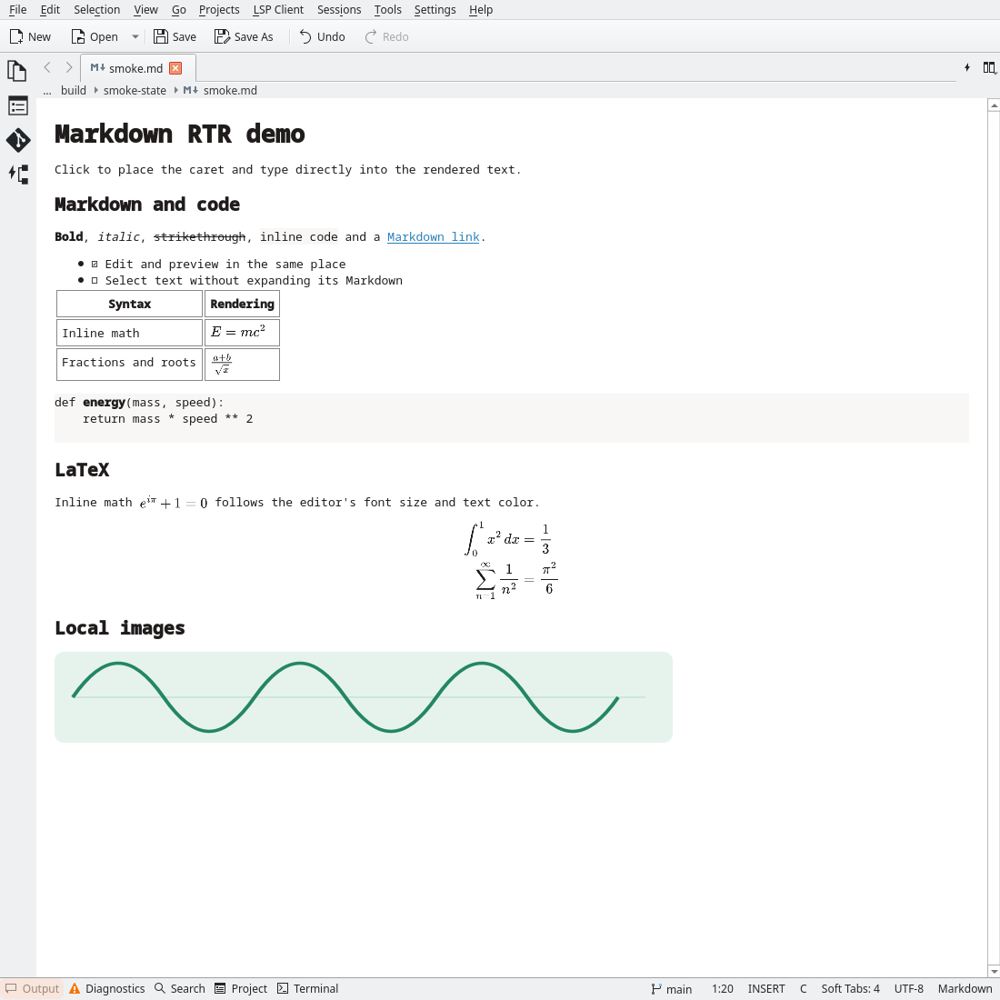

# Kate Markdown RTR

Native, editor-themed Markdown live editing for Kate, with embedded images and LaTeX math.

Edit Markdown directly in **the current document's editor area** using one continuous rich
text surface. Click to place the caret, drag to select, and type normally. Completed Markdown
stays rendered while you edit; incomplete delimiters remain literal text. Clicking, selecting
and scrolling never expand source or switch editing modes. Clicks, selection and caret
repositioning preserve the vertical scroll offset, including beside tall images. Use the wheel,
scrollbar or Page Up/Down to scroll; typing can follow the insertion point. Kate owns saving
and undo.



## Features

- CommonMark/GFM headings, paragraphs, emphasis, block quotes, ordered and unordered lists,
  task lists, tables, strikethrough, links, autolinks, inline code and fenced code blocks.
- Local images fitted to the available width, pasted screenshots and dropped image files.
  Optional asynchronous HTTP(S) image loading.
- Inline math with `$...$` or `\(...\)`; display math with `$$...$$` or `\[...\]`.
  Fractions, roots, scripts, sums, integrals, matrices, `aligned`, `cases` and other common
  LaTeX math expressions.
- Fonts, sizes, background, text, selection and syntax colors follow the active Kate
  editor configuration. Equations use MathJax math glyphs with the editor's size and text color.
- `KSyntaxHighlighting` for rendered code blocks, using installed language definitions such as `cpp`, `python`,
  `js`, `tex` and `latex`.

Try the [demo document](docs/demo.md) or see the [rich text editing screenshot](docs/real-kate-edit.png).

## Build and run

Requires CMake 3.28+, C++20, Qt 6.5+ and KDE Frameworks 6. Use development packages matching
the Qt/KF versions of your Kate installation. See [test results](docs/testing.md) for the
environment actually validated for this release.

Fedora dependencies and build commands:

```sh
sudo dnf install kate cmake ninja-build gcc-c++ extra-cmake-modules \
  qt6-qtbase-devel qt6-qtdeclarative-devel qt6-qtsvg-devel \
  kf6-ktexteditor-devel kf6-kcoreaddons-devel kf6-kxmlgui-devel \
  kf6-ki18n-devel kf6-syntax-highlighting-devel

git clone git@github.com:gtg2619/kate-markdown-rtr.git
cd kate-markdown-rtr
cmake -S . -B build -G Ninja -DCMAKE_BUILD_TYPE=Release \
  -DCMAKE_INSTALL_PREFIX="$HOME/.local" -DKDE_INSTALL_PLUGINDIR=lib/qt6/plugins
cmake --build build --parallel 4
./scripts/run-dev.sh docs/demo.md
```

1. Enable **Markdown RTR** in **Settings → Configure Kate → Plugins**.
2. Open a `.md` file: live rendering starts automatically. Existing Markdown tabs also activate
   when the plugin is enabled. Saving an untitled document as `.md` activates it as well.
3. Click to position the caret and type directly into the rendered text. Drag or Shift+click
   to select across paragraphs. No source expansion is involved.
4. Use **Ctrl+Shift+M** or **View → Markdown Live Editing** to turn RTR off or back on.
   A manual choice is remembered for that open view, including tab switches and Save As.
   New views default to live rendering. **Esc remains available for Kate's panels and dialogs.**

Enter creates a paragraph; Shift+Enter inserts a Markdown hard break. Inside a fenced code
block, Enter inserts a literal newline. In tables, Enter and Tab move between cells.
Ctrl+A selects the rendered document. Copy preserves the corresponding Markdown, including
formatting and embedded objects. Ctrl+Z / Ctrl+Shift+Z use Kate's undo and redo history;
Ctrl+S saves normally. Ctrl+Enter is retained as a harmless compatibility shortcut.

Images and equations are atomic inline objects: select, copy, replace or delete them without
revealing their source. To change an existing formula's TeX or a link/image destination,
explicitly toggle RTR off with Ctrl+Shift+M. Native find, replace and go-to-line also return
to Kate's source editor. Raw Markdown is never expanded by caret movement or selection.

Install into the user directory configured above:

```sh
cmake --install build --strip
QT_PLUGIN_PATH="$HOME/.local/lib/qt6/plugins${QT_PLUGIN_PATH:+:$QT_PLUGIN_PATH}" kate --new
```

Keep this `QT_PLUGIN_PATH` in your Kate launch environment. To uninstall, close Kate and
remove `~/.local/lib/qt6/plugins/kf6/ktexteditor/katemarkdownlive.so` and
`~/.local/share/katemarkdownlive`. The internal plugin ID remains `katemarkdownlive`.

## Images and equations

Images use standard Markdown: ``. Relative local paths
resolve against the document's directory. Pasting an image saves a PNG
under `<document filename>.assets/` next to the saved Markdown file and inserts a relative
link. SHA-256 filenames deduplicate identical images. Undo removes the inserted Markdown
but keeps the asset, which may be referenced elsewhere. Save an untitled document before
pasting a screenshot. Dropping image files inserts links.

Remote images are disabled by default. Enable **View → Load Remote Images in Markdown**
for HTTP(S) images in the current window. This preference lasts for the window session.
Downloads allow 4 concurrent requests, 32 pending requests, a 10-second timeout and 5 redirects.
Images are limited to 8 MiB per file and 16 megapixels before decoding. Missing, corrupt or
oversized images show a placeholder. Toggle source/preview to refresh a replaced local image.

```markdown
Inline: $E=mc^2$, or \(\frac{a}{b}\).

$$
\begin{aligned}
a^2+b^2 &= c^2 \\
\int_0^1 x^2\,dx &= \frac{1}{3}
\end{aligned}
$$
```

The math engine includes MathJax's `base`, `ams`, `newcommand`, `boldsymbol` and `mathtools`
packages. Dollar signs inside code, links and image syntax are not treated as math;
use `\$` for a literal dollar sign. Local macros apply only to their current formula.
Pending and invalid equations retain an object placeholder. Unclosed math delimiters stay
plain text. The engine typesets math; it does not execute complete LaTeX documents, external
commands or dynamically loaded packages.

## Implementation and limits

[cmark-gfm](https://github.com/github/cmark-gfm) supplies AST source ranges; Qt's
`QTextDocument` supplies native layout. KTextEditor always owns the original source.
Markdown is never regenerated from HTML, so unrelated source formatting is preserved.
Qt's Markdown display interface alone does not provide the source ranges needed for editing.

[MathJax 3.2.2](https://github.com/mathjax/MathJax-src/tree/3.2.2) runs in a lazily started
background `QJSEngine`, generates SVG and uses QtSvg for native rendering. There is no
WebEngine or helper browser process. Normal plugin builds and runtime do not need Node.js.
Rendering dependencies are bundled and hash-checked for offline builds and use. See
[third-party details](third_party/README.md) for versions, licenses and bundle reproduction.

The editor uses one native `QTextEdit` and a source map for semantic text, escaped characters,
entities, table cells and embedded objects. Interior word edits update that map incrementally;
syntax changes reparse the document. Qt calculates document geometry before browsing, so
scrolling does not replace estimated block heights. Image dimensions are read before painting;
new asynchronous resources, font changes and window resizing can still change layout.

Math SVG and raster caches each allow 8 MiB; decoded image caching allows 16 MiB. Each formula
allows at most 8192 characters, the formula queue allows 64 pending items, and conversions
have a deadline. These are resource guards, not process isolation for arbitrary hostile input.
The widget creates no native child windows and keeps its minimum size independent of its
current size, allowing Kate split panes to shrink normally.

Raw HTML is inert. Mermaid, HTML embeds, equation numbering/references and math inside link
labels are not supported. Text dragging copies its Markdown at the drop location. Blank lines
follow Markdown paragraph semantics rather than showing every source newline. Documents above
1,048,576 UTF-16 units or about 4000 AST blocks return to Kate's source editor. A source map
that cannot be validated also returns to source mode instead of applying uncertain edits.

## Tests and license

```sh
./scripts/test.sh
```

Tests cover real KTextEditor documents, plugin loading/unloading, saving, undo, input methods,
Unicode preservation, external edits, read-only mode, splitter shrinking, equations, images,
malformed inputs, cache limits and performance regressions. Normal and ASan/UBSan/LeakSanitizer
builds pass locally; see [test results](docs/testing.md).

Plugin code is [MIT licensed](LICENSE). cmark-gfm and MathJax retain their upstream licenses.
